# SecureGate: Hardened Authentication Portal


A full stack web application (HTML/CSS/JS + Flask + SQLite) that implements modern
authentication security: **TOTP two-factor auth (RFC 6238, written from scratch)**,
role-based access control, per-IP rate limiting, account lockout, CSRF protection,
security headers and a **tamper-evident, hash-chained audit log**.

## Objective
Demonstrate secure design against the most common web attacks, and prove each defence
with automated tests (`pytest`, 20+ tests, including the official RFC test vectors).

## Architecture
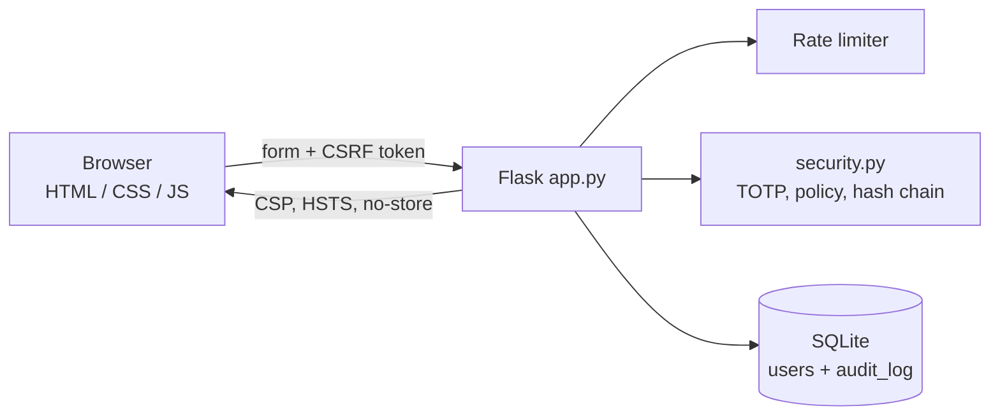

## Tools & Technologies
Python 3, Flask, Jinja2, SQLite, HTML5, CSS3, JavaScript, pytest, GitHub Actions (CI), Git.

## Features
- Registration with password policy, live strength meter, common-password and username checks
- scrypt salted password hashing (Werkzeug)
- Two-factor authentication (TOTP) with replay protection; works with Google Authenticator / Authy
- Role-based access control (`admin` / `user`) with an admin panel
- Per-IP rate limiting on auth endpoints (HTTP 429) and per-account lockout after 5 failures
- Tamper-evident audit log: every entry stores the SHA-256 of the previous one; the admin panel verifies the chain
- Session fixation defence, HttpOnly + SameSite cookies, 15-minute session timeout, `Cache-Control: no-store`
- Security headers: CSP, X-Frame-Options, X-Content-Type-Options, Referrer-Policy, HSTS (when HTTPS enabled)

## Threat model
| Threat | How it is attacked | Defence | Where |
|---|---|---|---|
| Credential stuffing / brute force | Automated guessing | Rate limit (429) + lockout after 5 failures | `guard()`, `record_failure()` |
| Database leak | Stolen DB dump | scrypt salted hashes, no plaintext | `generate_password_hash` |
| SQL injection | `' OR '1'='1` in inputs | Parameterized queries everywhere | all `db.execute(..., (args))` |
| XSS | Script in profile fields | Jinja auto-escaping + CSP `default-src 'self'` | templates, `security_headers()` |
| CSRF | Forged cross-site POST | Per-session token checked on every POST | `guard()` |
| Session fixation / hijacking | Reusing a pre-login session | `session.clear()` on login, HttpOnly, SameSite, timeout | `complete_login()` |
| Stolen password | Phished credentials | TOTP second factor, codes single-use | `login_2fa()`, `verify_totp()` |
| Username enumeration | Different errors / timings | Generic error + dummy hash check | `login()` |
| Privilege escalation | Normal user opens `/admin` | Role re-read from DB on every request, 403 + audit event | `admin_required` |
| Log tampering | Attacker edits audit rows | Hash chain; admin panel shows TAMPERED | `verify_chain()` |
| Clickjacking | Embedding site in iframe | `X-Frame-Options: DENY`, `frame-ancestors 'none'` | `security_headers()` |

## OWASP Top 10 (2021) mapping
A01 Broken Access Control (RBAC) | A02 Cryptographic Failures (scrypt, TOTP) |
A03 Injection (parameterized SQL, escaping) | A04 Insecure Design (threat model, lockout) |
A05 Security Misconfiguration (headers, debug off) | A07 Identification and Authentication Failures (2FA, policy, rate limit) |
A08 Software and Data Integrity Failures (hash-chained log) | A09 Security Logging and Monitoring Failures (audit log)

## Execution steps
```bash
git clone https://github.com/<your-username>/securegate.git
cd securegate
pip install -r requirements.txt
python app.py                 # open http://127.0.0.1:5000
```
The **first account you register becomes the admin** (demo bootstrap).
Optional demo users: `python seed_demo.py`.

Run the tests:
```bash
pip install -r requirements-dev.txt
python -m pytest -q
```

## Demo (for screenshots)
1. Register (first user = admin), log in, open **Two-factor** and set up 2FA, scan or type the key into an authenticator app.
2. Log out and log in again: the 2FA prompt appears.
3. Enter a wrong password 5 times to see the lockout. Unlock from the **Admin** panel.
4. Admin panel shows "Audit log integrity: VERIFIED". Then edit a row (command below) and refresh: it shows **TAMPERED**.
   ```bash
   python -c "import sqlite3;c=sqlite3.connect('securegate.db');c.execute(\"UPDATE audit_log SET event='NOTHING_HAPPENED' WHERE id=1\");c.commit()"
   ```

## Output
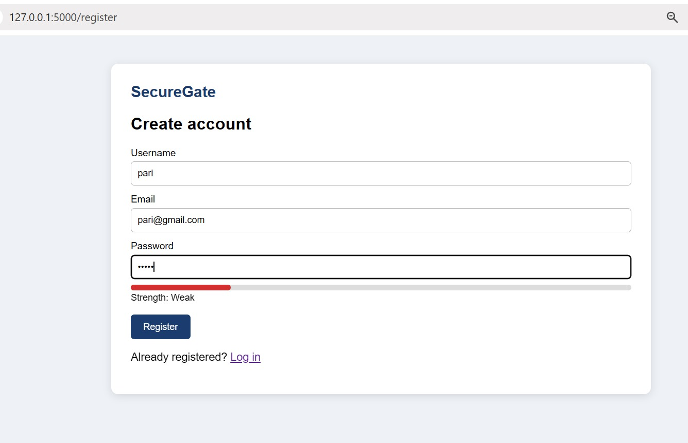
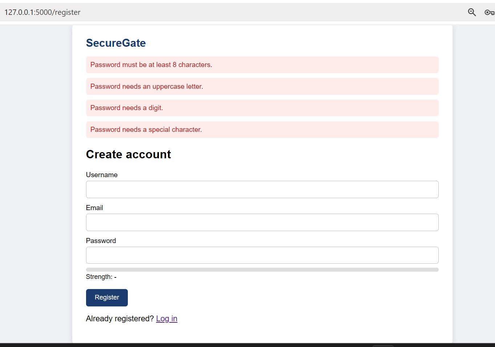
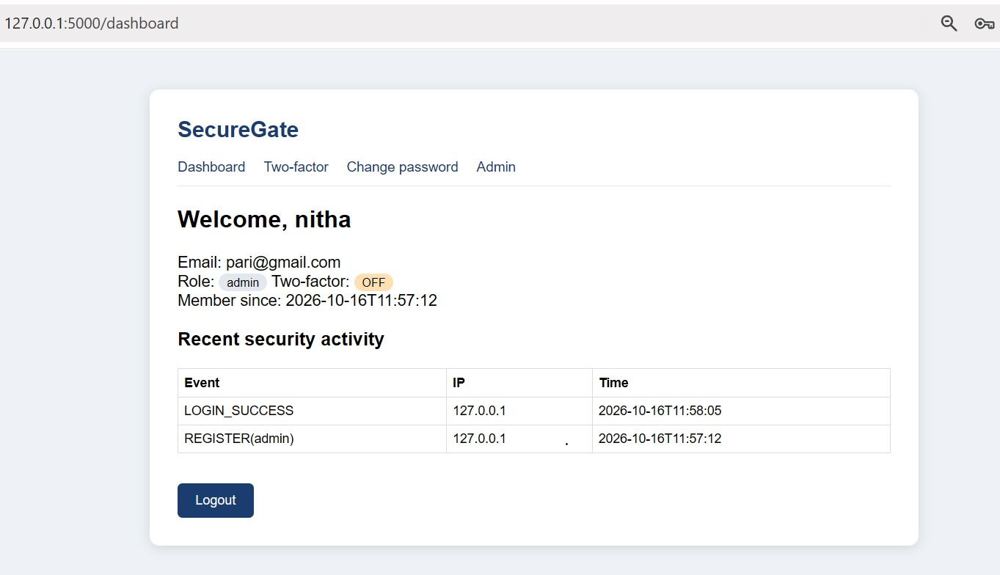
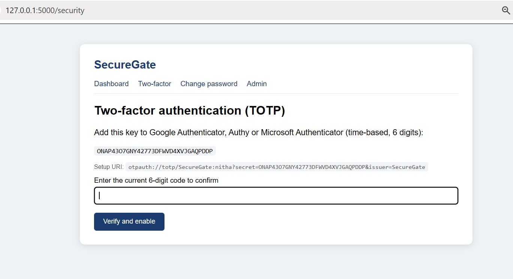
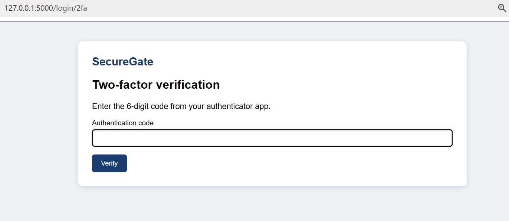
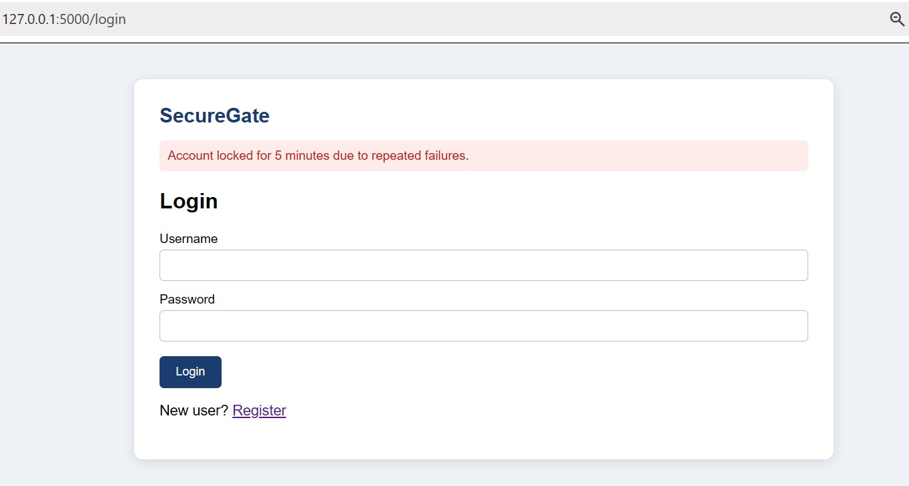
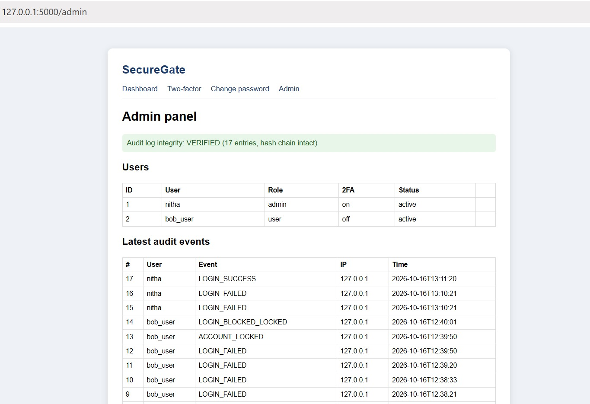
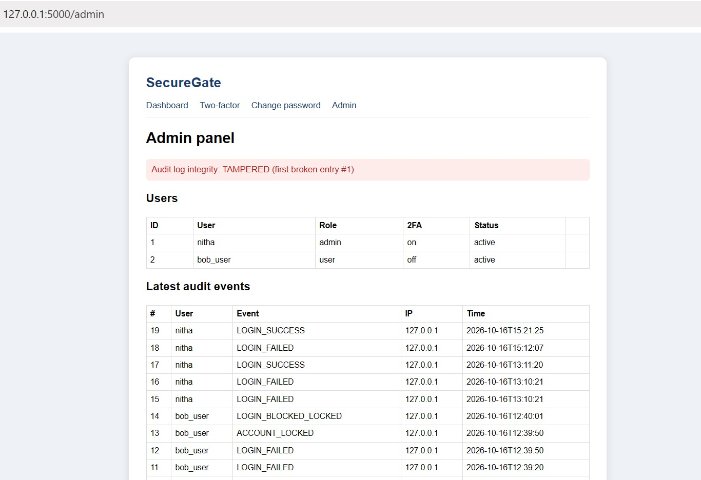
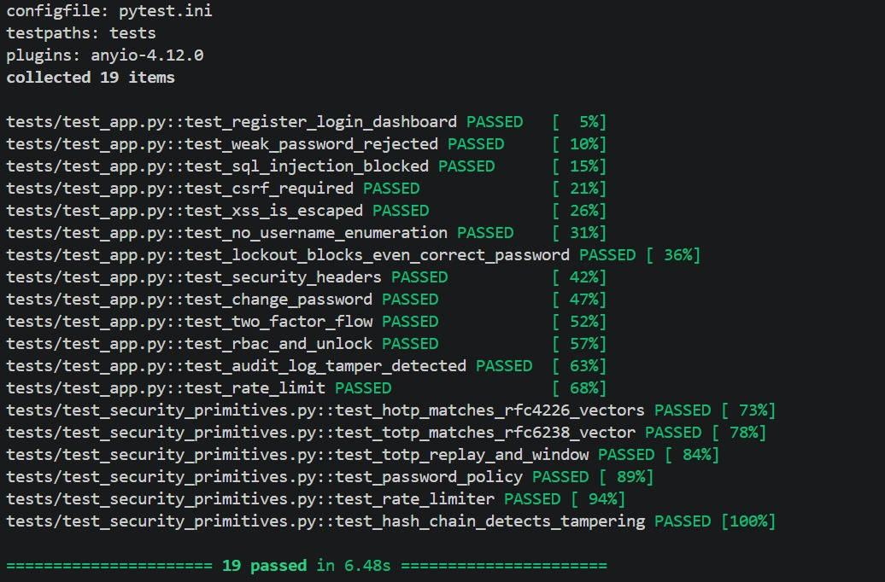
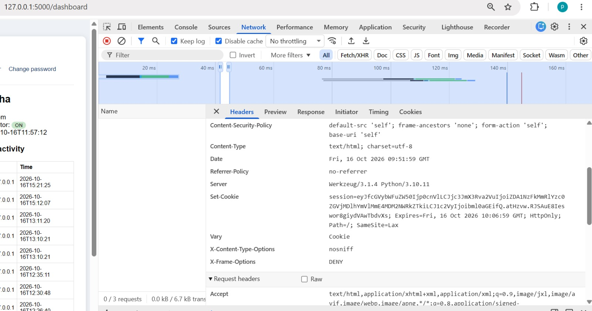

## Limitations and future work
Run behind HTTPS in production (set `FORCE_HTTPS=1` and a fixed `SECRET_KEY`); the rate limiter is in-memory
(use Redis for multiple workers); the hash chain detects edits but an attacker with full DB write access could
rebuild it, so anchor the latest hash externally; add email verification, recovery codes and WebAuthn.

## Author
<Your Name>, <USN>
